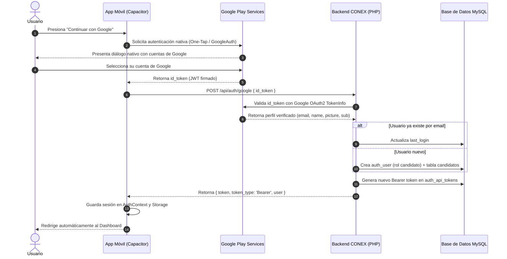

# Plan y Especificación Técnica: Autenticación con Google (Google Sign-In)

Este documento detalla la arquitectura, configuración y pasos de implementación para integrar el inicio de sesión nativo con **Google Sign-In** en la plataforma **CONEX** (App Móvil Ionic/Capacitor + Backend CodeIgniter 4).

---

## 1. Arquitectura del Flujo



---

## 2. Parámetros del Proyecto y Huellas Digitales

| Parámetro | Valor |
| :--- | :--- |
| **Nombre de la Aplicación** | `CONEX` |
| **Package Name (Android Application ID)** | `com.softlutionic.conex` |
| **URL Dominio Oficial** | `https://conex.softlutionic.com` |
| **URL Política de Privacidad** | `https://conex.softlutionic.com/politica-privacidad` |
| **URL Solicitud Eliminación de Cuenta** | `https://conex.softlutionic.com/eliminar-cuenta` |
| **SHA-1 (Certificado Debug local)** | `AC:6C:29:E6:CC:45:91:03:F6:98:BB:8C:25:71:F5:E3:0E:E6:A3:D2` |
| **SHA-256 (Certificado Debug local)** | `94:E9:54:8A:BA:BD:5F:79:BF:A9:CC:62:BD:96:7C:69:B5:44:E8:4C:8C:B1:C2:BB:A2:99:66:7A:B9:97:7E:C5` |

---

## 3. Configuración en Google Cloud Console

Para autorizar la autenticación desde Android y desde la web, se deben configurar los siguientes elementos en [Google Cloud Console](https://console.cloud.google.com/):

### 3.1. Pantalla de Consentimiento OAuth
1. Ir a **APIs y Servicios** > **Pantalla de consentimiento de OAuth**.
2. Seleccionar tipo de usuario: **Externo**.
3. Completar:
   - **Nombre de la aplicación:** `CONEX`
   - **Correo de asistencia al usuario:** Correo del desarrollador/administrador.
   - **Logotipo de la aplicación:** Logotipo oficial de CONEX.
   - **Dominio de la aplicación:**
     - Página principal: `https://conex.softlutionic.com`
     - Política de privacidad: `https://conex.softlutionic.com/politica-privacidad`
     - Términos del servicio: `https://conex.softlutionic.com`
4. **Permisos (Scopes):** Seleccionar:
   - `.../auth/userinfo.email`
   - `.../auth/userinfo.profile`
   - `openid`

### 3.2. Credenciales OAuth 2.0 Requeridas

Se requieren **dos clientes OAuth**:

#### Cliente 1: ID de cliente de aplicación web (Web Client ID)
- **Tipo de aplicación:** Aplicación web (Web application).
- **Nombre:** `CONEX Web Client`
- **Uso:** Este ID actúa como `serverClientId` en Capacitor para emitir el `id_token` que se envía a la API de CONEX.
- **Resultado:** Se obtendrá un identificador con formato:  
  `XXXXXXXXXXXXXXXX.apps.googleusercontent.com`

#### Cliente 2: ID de cliente de Android (Android Client ID)
- **Tipo de aplicación:** Android.
- **Nombre:** `CONEX Android Client`
- **Nombre de paquete:** `com.softlutionic.conex`
- **Huella digital del certificado SHA-1:**
  - Para pruebas locales: `AC:6C:29:E6:CC:45:91:03:F6:98:BB:8C:25:71:F5:E3:0E:E6:A3:D2`
  - Para producción: La huella SHA-1 de `conex-release-key.jks` y la huella de firma de la app de Google Play Console.

---

## 4. Implementación en Backend (CodeIgniter 4)

### 4.1. Endpoint de Autenticación
- **Ruta:** `POST /api/auth/google`
- **Filtro de seguridad:** Rate limiting (`apiRate:10,60`)
- **Payload esperado:**
  ```json
  {
    "id_token": "eyJhbGciOiJSUzI1NiIsImtpZCI6...",
    "device_name": "Samsung Galaxy S24"
  }
  ```

### 4.2. Validación Criptográfica del Token
El backend valida el token contra el servicio oficial de Google:
`https://oauth2.googleapis.com/tokeninfo?id_token=<id_token>`

Condiciones de validación:
1. `http_code == 200`
2. `iss` coincide con `accounts.google.com` o `https://accounts.google.com`.
3. `exp > time()` (token no expirado).
4. `email_verified == true`.

### 4.3. Lógica de Usuario
- **Usuario existente:** Inicia sesión directamente, actualiza `last_login`, emite un Bearer token con vigencia de 30 días y retorna el payload del usuario.
- **Usuario nuevo:**
  - Asigna rol de `candidato`.
  - Genera nombre de usuario alfanumérico único.
  - Guarda nombre, apellido, correo verificado y URL de avatar de Google.
  - Asigna clave criptográfica aleatoria de 32 bytes (acceso exclusivo por Google o recuperación).
  - Inserta el registro complementario en la tabla `candidatos`.
  - Emite el token de sesión Bearer y retorna el payload.

---

## 5. Implementación en App Móvil (Capacitor / Ionic)

### 5.1. Dependencia Oficial
```bash
npm install @codetrix-studio/capacitor-google-auth
```

### 5.2. Configuración en `capacitor.config.ts`
```typescript
plugins: {
  GoogleAuth: {
    scopes: ['profile', 'email'],
    serverClientId: 'TU_WEB_CLIENT_ID.apps.googleusercontent.com',
    forceCodeForRefreshToken: false,
  }
}
```

### 5.3. Configuración en `android/app/src/main/res/values/strings.xml`
```xml
<resources>
    <string name="app_name">CONEX</string>
    <string name="title_activity_main">CONEX</string>
    <string name="package_name">com.softlutionic.conex</string>
    <string name="custom_url_scheme">com.softlutionic.conex</string>
    <string name="server_client_id">TU_WEB_CLIENT_ID.apps.googleusercontent.com</string>
</resources>
```

### 5.4. Botón en Pantallas de Acceso (`Login.tsx` y `Registro.tsx`)
- Botón estilizado conforme a la guía de marca de Google y One UI:
  - Altura mínima: 48dp (cumpliendo accesibilidad de Google Play).
  - Ícono oficial multicolor de Google (SVG).
  - Texto: *"Continuar con Google"*.
  - Efecto de carga táctil accesible.

---

## 6. Checklist de Verificación y Pruebas

- [x] Endpoint `POST /api/auth/google` configurado en `Routes.php`.
- [x] Lógica de validación de tokens y auto-registro programada en `AuthController.php`.
- [x] Código PHP validado sin errores de sintaxis y desplegado al servidor de producción.
- [ ] Creación de credenciales (Web Client ID y Android Client ID) en Google Cloud Console.
- [ ] Instalación del plugin `@codetrix-studio/capacitor-google-auth` en `app-conex`.
- [ ] Configuración del Client ID en `capacitor.config.ts` y `strings.xml`.
- [ ] Integración de botones UI en `Login.tsx` y `Registro.tsx`.
- [ ] Prueba de login nativo en dispositivo físico / emulador Android.

